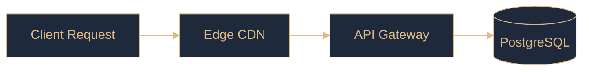
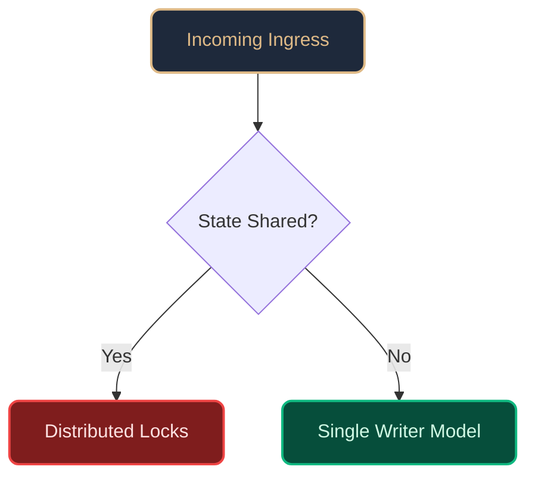
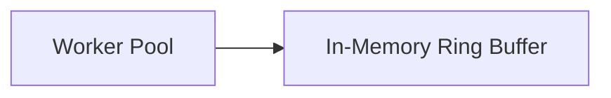

# 10. Chart Coloring and Vector Diagrams

> Comprehensive guide on controlling diagram and chart colors, themes, and vector SVGs in Paperforge

* **Package:** `@vivekkushwaha66/paperforge`
* **License:** MIT

---

## 1. Overview

Paperforge provides first-class support for both **Mermaid diagrams** and **Direct Vector SVGs** within your Markdown source files. You can publish complex architecture topologies, sequence flows, data pipelines, and state machines with precise color grading that matches your publication theme.

Paperforge supports two distinct rendering pipelines for diagrams:

| Pipeline | Renderer | How Diagrams are Rendered | Ideal For |
| :--- | :--- | :--- | :--- |
| **System Browser** | `system-browser` | Injected Mermaid engine renders DOM `<svg>` in Chromium/Edge | Full-bleed HTML/CSS cards, carousel slides, complex CSS effects |
| **Direct PDF Vector** | `pdfmake` | Native `{ svg: ... }` vector primitives compiled into PDF | Zero-browser environments, high-speed CLI builds, CI/CD runners |

---

## 2. Controlling Colors in Mermaid Diagrams

Mermaid diagrams can be styled and colored using four flexible layers:

### Layer 1: In-Diagram `%%{init: ...}%%` Directive (Recommended)

Mermaid provides direct theme configuration at the top of any diagram block. This allows you to customize the exact palette for primary nodes, borders, text, and link lines.

````markdown

````

#### Available Mermaid Theme Variables:

| Variable | Description | Example |
| :--- | :--- | :--- |
| `primaryColor` | Background color for standard nodes | `#1E293B` |
| `primaryTextColor` | Text color inside nodes | `#DFBA87` or `#FFFFFF` |
| `primaryBorderColor` | Border stroke color for nodes | `#DFBA87` or `#38BDF8` |
| `lineColor` | Connector stroke color for arrows/links | `#DFBA87` |
| `edgeLabelBackground` | Background for text badges on connecting lines | `#111625` |
| `secondaryColor` | Fill color for subgraphs and clusters | `#0F172A` |
| `tertiaryColor` | Alternating rows or secondary accents | `#1E293B` |
| `fontFamily` | Typography used for node labels | `'Helvetica, sans-serif'` |

---

### Layer 2: Node-Level `style` and `classDef` Directives

You can pinpoint specific nodes, highlight critical paths, or define reusable color classes inside the diagram syntax:

````markdown

````

- `classDef <name> fill:<color>,stroke:<color>,stroke-width:<px>,color:<text-color>`
- `:::<name>` applies the class to a node.
- `style <node-id> fill:<color>,stroke:<color>` styles an individual node inline.

---

### Layer 3: Frontmatter `accent_color` Cascading

When authoring slides or chapters, defining `accent_color` in the document frontmatter cascades to the diagram card containers, running headers, and accent bars:

```markdown
---
title: "Critical Path Throughput"
order: 4
background: "#08101E"
accent_color: "#38BDF8"
---

# Critical Path Optimization

The diagram container inherits the blue accent glow:


```

---

### Layer 4: Global CSS Print Theme Overrides (`theme.css`)

In `system-browser` mode, Paperforge applies CSS print themes that can override or enhance Mermaid nodes globally. You can define custom CSS in your `paperforge.yaml`:

```yaml
theme:
  css: "./custom-theme.css"
```

In `custom-theme.css`:

```css
/* Custom Diagram Node Styles */
.mermaid .node rect,
.mermaid .node polygon,
.mermaid .node circle {
  fill: #111625 !important;
  stroke: #DFBA87 !important;
  stroke-width: 1.5px !important;
  rx: 8px !important;
}

/* Node Label Typography */
.mermaid .label text,
.mermaid .node .label {
  fill: #DFBA87 !important;
  color: #DFBA87 !important;
  font-family: -apple-system, BlinkMacSystemFont, "Segoe UI", Roboto, sans-serif !important;
  font-weight: 600 !important;
}

/* Connecting Arrows & Link Strokes */
.mermaid .flowchart-link,
.mermaid .edgePath path {
  stroke: #DFBA87 !important;
  stroke-width: 2px !important;
}

/* Arrowhead Markers */
.mermaid .marker {
  fill: #DFBA87 !important;
  stroke: #DFBA87 !important;
}
```

---

## 3. Controlling Colors in Direct Vector SVGs

For infographics, complex microservice topographies, or data charts, Paperforge allows writing raw vector SVG markup directly in Markdown or via fenced ```` ```svg ```` code blocks.

### Example 1: Direct Fenced SVG Code Block

````markdown
```svg
<svg width="680" height="200" viewBox="0 0 680 200">
  <!-- Card Background -->
  <rect width="680" height="200" rx="12" fill="#0C2533" stroke="#38BDF8" stroke-width="2"/>
  
  <!-- Left Ingress Node -->
  <rect x="40" y="55" width="160" height="90" rx="8" fill="#13384D" stroke="#38BDF8" stroke-width="1.5"/>
  <text x="120" y="95" fill="#38BDF8" font-family="Helvetica" font-size="14" font-weight="bold" text-anchor="middle">API Ingress</text>
  <text x="120" y="120" fill="#94A3B8" font-family="Helvetica" font-size="11" text-anchor="middle">mTLS 1.3 Termination</text>

  <!-- Animated Vector Link -->
  <path d="M 200 100 L 280 100" stroke="#38BDF8" stroke-width="2.5" fill="none"/>

  <!-- Center Broker Node -->
  <rect x="280" y="45" width="160" height="110" rx="8" fill="#13384D" stroke="#F59E0B" stroke-width="1.5"/>
  <text x="360" y="85" fill="#F59E0B" font-family="Helvetica" font-size="14" font-weight="bold" text-anchor="middle">Apache Kafka</text>
  <text x="360" y="110" fill="#E2E8F0" font-family="Helvetica" font-size="11" text-anchor="middle">Partitioned Topic</text>
  <text x="360" y="130" fill="#94A3B8" font-family="Helvetica" font-size="10" text-anchor="middle">P99 &lt; 2ms</text>

  <!-- Output Node -->
  <path d="M 440 100 L 520 100" stroke="#F59E0B" stroke-width="2.5" fill="none"/>
  <rect x="520" y="55" width="120" height="90" rx="8" fill="#13384D" stroke="#34D399" stroke-width="1.5"/>
  <text x="580" y="95" fill="#34D399" font-family="Helvetica" font-size="14" font-weight="bold" text-anchor="middle">Flink Stream</text>
  <text x="580" y="120" fill="#94A3B8" font-family="Helvetica" font-size="11" text-anchor="middle">Stateful Joins</text>
</svg>
```
````

### SVG Color Attributes:

- `fill`: Sets the background fill of shapes (`#0F172A`, `#1E293B`, `none`, `url(#gradient)`).
- `stroke`: Sets the perimeter or path color (`#DFBA87`, `#38BDF8`, `#EF4444`).
- `stroke-width`: Line thickness in points/pixels (`1.5`, `2`, `3`).
- `stroke-dasharray`: Creates dashed connector lines (e.g. `stroke-dasharray="4"` for asynchronous calls).
- `rx`, `ry`: Corner rounding for rectangular nodes.
- `<linearGradient>`: High-end color fades from start to finish.

### SVG Gradients Example:

```xml
<defs>
  <linearGradient id="goldGradient" x1="0%" y1="0%" x2="100%" y2="100%">
    <stop offset="0%" stop-color="#DFBA87" />
    <stop offset="100%" stop-color="#8C6A3C" />
  </linearGradient>
</defs>
<rect width="400" height="100" rx="8" fill="url(#goldGradient)" />
```

---

## 4. Curated Color Palettes for Technical Slides

Here are battle-tested color palettes designed for high-contrast publications and carousel slides:

### Obsidian & Warm Gold (Executive Architecture)
* Background: `#0B0F19` or `#111625`
* Primary Accent: `#DFBA87`
* Container Fill: `#1E293B`
* Secondary Accent: `#38BDF8`
* Muted Text: `#94A3B8`

### Deep Marine & Cyan (Data Engineering & Cloud)
* Background: `#061A23`
* Primary Accent: `#38BDF8`
* Container Fill: `#0C2533`
* Secondary Accent: `#34D399`
* Muted Text: `#64748B`

### Royal Violet & Lavender (AI & Compute Systems)
* Background: `#180D2B`
* Primary Accent: `#A78BFA`
* Container Fill: `#24143E`
* Secondary Accent: `#F472B6`
* Muted Text: `#C4B5FD`

---

## 5. Summary Matrix

| Styling Method | Scope | System Browser | PDFMake | Best Used For |
| :--- | :--- | :---: | :---: | :--- |
| `%%{init: ...}%%` | Single Mermaid diagram | ✅ | ✅ | Customizing Mermaid node & line colors |
| `classDef` / `style` | Specific nodes in diagram | ✅ | ✅ | Highlighting bottlenecks or safe paths |
| `accent_color` in frontmatter | Entire page & cards | ✅ | ✅ | Synchronizing card borders and headers |
| CSS overrides (`theme.css`) | All diagrams globally | ✅ | ❌ | Centralized corporate design systems |
| Direct `<svg>` markup | Custom vector graphics | ✅ | ✅ | Infographics, custom charts, microservices |
