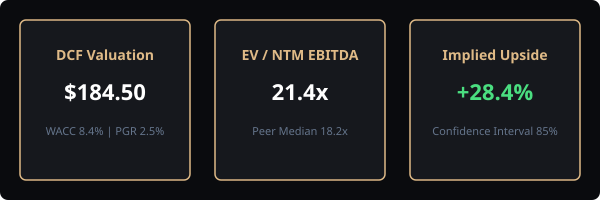

# Executive Summary & Framework

Artificial intelligence enables equity analysts to compress hours of financial synthesis into minutes while maintaining institutional rigor.

## Research Objectives

The goal of this publication is to provide reproducible, audit-ready prompting templates for:

1. **Earnings Call Transcript Mining:** Extracting subtle executive sentiment and capex cues.
2. **Moat & Competitor Benchmarking:** Assessing Porter's Five Forces dynamically.
3. **Discounted Cash Flow (DCF) Scenario Modeling:** Building bull, base, and bear valuation trees.

## Core Analytical Principles

> "Price is what you pay; value is what you get." — Warren Buffett

When prompting LLMs for financial valuation, never request single-point estimates. Always force the model to provide sensitivity bounds and intermediate calculation steps.
