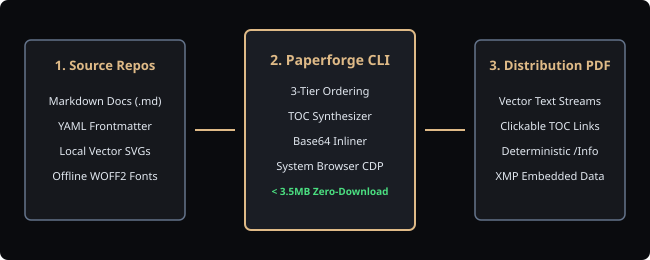

# System Architecture & Pipeline

The Paperforge publishing workflow operates across three decoupled layers:

## Pipeline Stages

1. **Static Ingestion:** Configuration parsing and frontmatter validation via Zod schemas.
2. **Deterministic Sequencing:** Lexical and explicit priority document resolution.
3. **Typography Inlining:** Local font binaries converted to Base64 data URIs.
4. **Browser Dispatch:** Headless browser automation executing standard CSS `@page` layouts.
5. **Binary Post-Processing:** Deterministic `/Info` dictionary and XMP metadata injection with `pdf-lib`.
