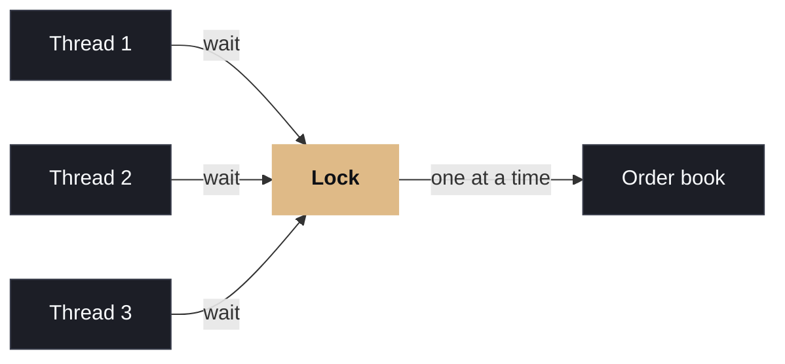

# The common instinct is to add locks.

Thousands of orders arrive in the same millisecond, all competing to change the same order book. More servers usually make the contention worse.

Lock the book, process, release. It works at low volume, then collapses under load because threads wait on each other instead of working.

  
PROBLEM PATH

