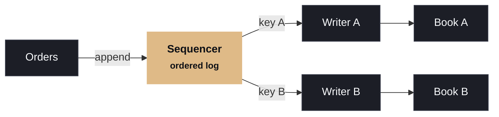

# Give each book one writer, and put every event in order.

Single-writer ownership

One thread owns each order book. No locks, no contention. Parallelism comes from partitioning by instrument, not from sharing one structure.

Sequence everything

Every event gets a position in a single ordered log before it's processed, so behavior is deterministic and can be replayed and audited.

  
BETTER PATH

