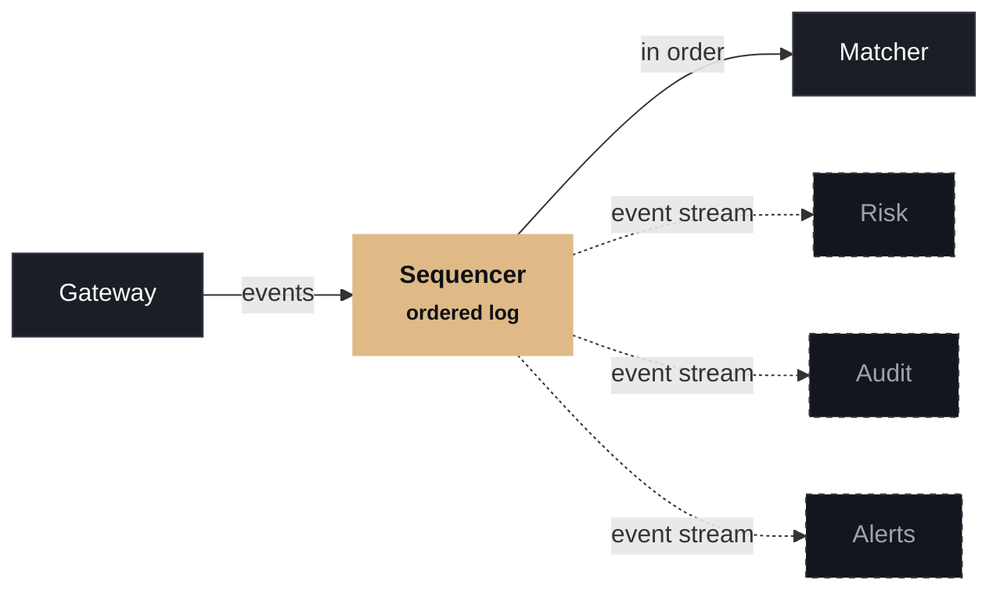

# Keep the critical path small and predictable.

Keep the hot path small

Matching logic does only matching. Logging, risk reporting and notifications happen elsewhere, fed by the same event stream.

Design around the cache

Memory layout and allocation patterns matter more than the class hierarchy. Pausing for garbage collection is a design flaw, not a tuning problem.

  
HOT PATH &amp; OFF THE HOT PATH

