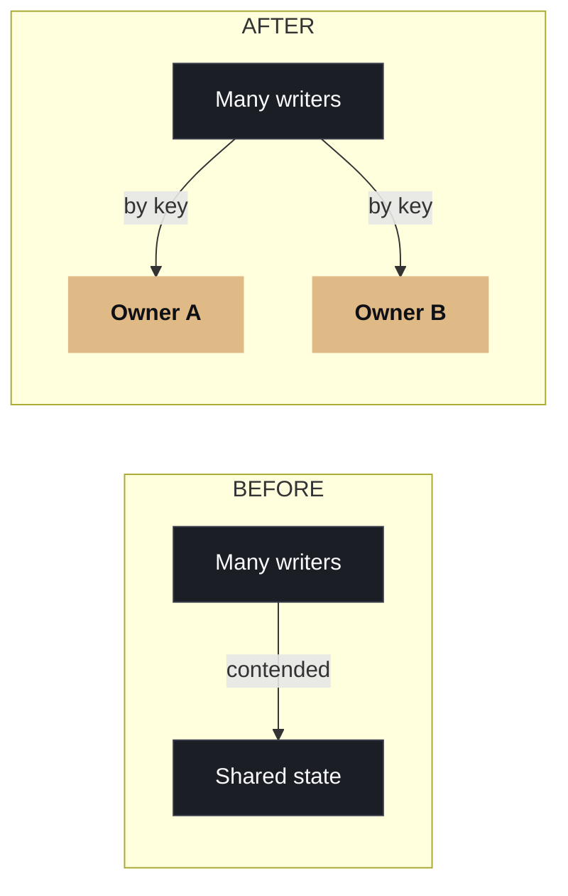

# Stop making shared state safe. Ask whether it needs to be shared.

Payments, inventory, booking and real-time collaboration share one shape: many writers, one piece of contested state.

What's the most contested piece of state in your architecture, and how did you resolve it?

